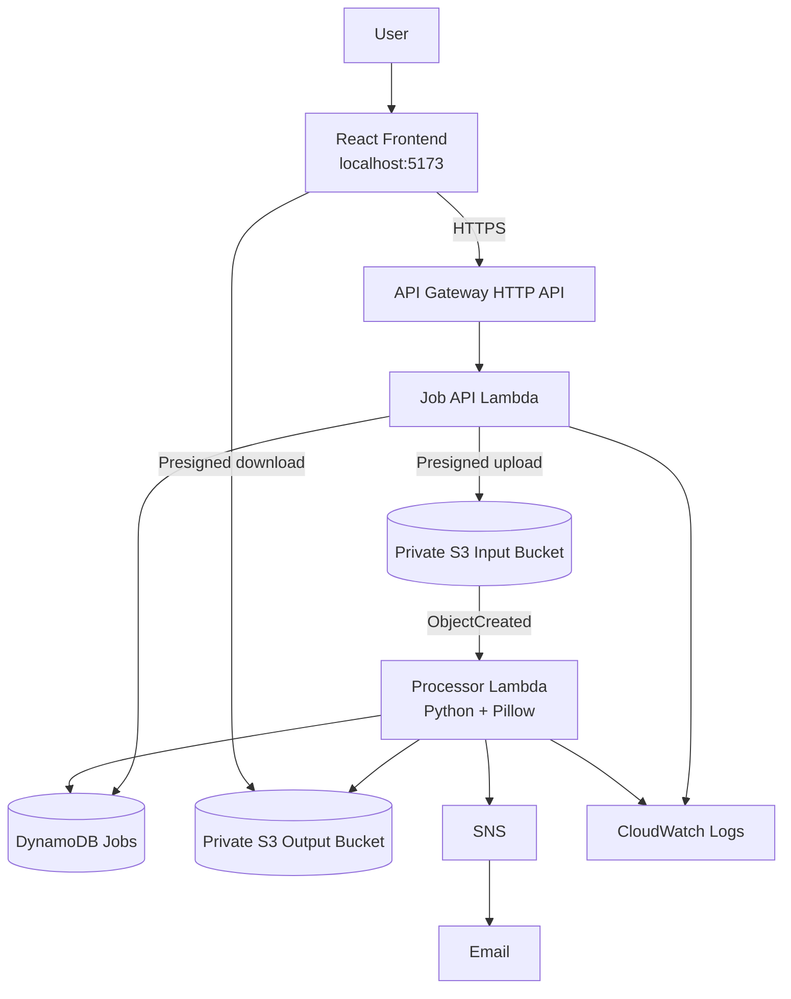

# ImagePreprocessing — Serverless Image Preprocessing System Using AWS

Upload a JPG or PNG, pick the operations you want (resize, grayscale, compression,
pixelation), preview the results, and download the ones you like. The backend is fully
serverless on AWS and the infrastructure is defined with Terraform.

The React frontend runs **locally** (http://localhost:5173) and talks to the real AWS
backend. There is no public website hosting (no CloudFront and no frontend bucket).

> 📘 **New to the code or preparing for interviews?** Read [docs/CODE_GUIDE.md](docs/CODE_GUIDE.md):
> a step-by-step walkthrough of one request, a file-by-file guide, test types, and
> interview questions with answers. The source files are also commented; search for
> `INTERVIEW:` to find the interview notes.

## Architecture



How to read the diagram:
- **"Presigned upload":** the Job API Lambda *signs* a short-lived upload form. The image
  bytes go straight from the browser to the private input bucket, not through the API.
- **"Presigned download":** previews and downloads come straight from the private output
  bucket, using short-lived signed links returned by the results API.
- **Not shown:** the React app is served from your machine by the Vite dev server. All
  infrastructure is created by Terraform (`infra/`).

**Workflow**

1. The browser calls `POST /api/jobs`. The Job API Lambda validates the request, creates a
   job ID and a random **job access token**, stores the job (with only a *hash* of the
   token) in DynamoDB as `CREATED`, and returns a 5-minute presigned S3 upload form.
2. The browser uploads the image straight to the private input bucket. S3 itself enforces
   the exact file size and content type written into the signed form.
3. The browser calls `POST /api/jobs/{jobId}/complete-upload`. The API checks the stored
   object's size and type and marks the job `UPLOADED`.
4. The S3 `ObjectCreated` event triggers the Processor Lambda. It claims the job with a
   conditional DynamoDB update (`PROCESSING`), validates the real file contents with Pillow,
   produces the results, saves them to the output bucket, and marks the job `COMPLETED`
   (or `FAILED`). Then it sends an SNS notification.
5. The browser polls `GET /api/jobs/{jobId}`. When the job is complete it calls
   `GET /api/jobs/{jobId}/results` for 5-minute presigned preview/download URLs.

Job statuses: `CREATED → UPLOADED → PROCESSING → COMPLETED` or `FAILED`.

## Features and processing behaviour

Supported formats: **JPG, JPEG, PNG**. Maximum file size: **10 MB**. Maximum dimensions:
10,000 px per side and 40 megapixels in total.

| Operation | Behaviour |
|---|---|
| **Resize** | Default max 600×400. Keeps the aspect ratio by default: fits inside the box, never stretches, never enlarges small images. Can be switched to an exact size. |
| **Grayscale** | Converts to grayscale. Transparent PNGs keep their transparency (`LA` mode). |
| **Compression** | JPEG: quality 10–100 (default 75). PNG: lossless optimization (no slider). A file is not guaranteed to get smaller; the UI shows the real change. |
| **Pixelation** | Level 8–128 in steps of 8 (default 16) = number of blocks along the **longer** side. The other side's block count follows the aspect ratio. Downscale + nearest-neighbour upscale. The output keeps the original size and proportions. Lower = blockier. |

**Results you get.** One result per selected operation (that operation alone, applied to
the original). If you select two or more, you also get a **Combined** result with all of
them applied in this fixed order:

> **1. Resize → 2. Grayscale → 3. Compression → 4. Pixelation**

Results keep the input format (JPEG stays JPEG, PNG stays PNG). EXIF orientation is
applied, and metadata (EXIF/GPS) is **not** copied into the outputs.

## Folder structure

```
ImagePreprocessing/
├── backend/
│   ├── src/imgproc/          # Lambda code (shared package)
│   │   ├── image_ops.py      # validation + resize/grayscale/compress/pixelate (Pillow)
│   │   ├── validation.py     # request & parameter validation
│   │   ├── tokens.py         # job access tokens (hash + constant-time compare)
│   │   ├── jobs.py           # DynamoDB state machine, conditional claims, leases
│   │   ├── job_api.py        # Job API Lambda handler (4 routes)
│   │   ├── processor.py      # Processor Lambda handler (S3 trigger)
│   │   └── config.py         # environment variables, boto3 clients
│   ├── tests/                # pytest suite (mocked AWS via moto)
│   ├── local/dev_server.py   # local API + mock AWS for running the app on your laptop
│   ├── requirements.txt      # Lambda runtime deps (Pillow)
│   └── requirements-dev.txt  # + boto3, moto, pytest
├── frontend/                 # React + Vite app
│   └── src/ (App.jsx, api.js, imageValidation.js, options.js, components/)
├── infra/                    # Terraform (S3, DynamoDB, Lambda, API GW, SNS, CloudWatch, IAM)
├── scripts/
│   ├── build_lambda.ps1      # builds Lambda packages with *Linux* Pillow wheels
│   ├── configure_frontend.ps1 # points the local React app at the deployed AWS API
│   └── e2e_test.py           # end-to-end HTTP test (local or deployed)
├── docs/
│   └── CODE_GUIDE.md         # beginner walkthrough + interview preparation
└── README.md
```

## Prerequisites

- Windows 11 with PowerShell
- Python 3.12, Node.js 20+ and npm
- AWS CLI v2, configured (`aws sts get-caller-identity` works)
- Terraform ≥ 1.6. To install: `winget install --id Hashicorp.Terraform -e --scope user`,
  then open a **new** terminal and check with `terraform version`.

## Local setup and running locally

Run these from the project folder in PowerShell:

```powershell
# Backend: virtual environment + dependencies
python -m venv backend\.venv
backend\.venv\Scripts\python.exe -m pip install -r backend\requirements-dev.txt

# Frontend dependencies
cd frontend; npm install; cd ..
```

Start the app with two terminals:

```powershell
# Terminal 1: local API + mock AWS (moto) on ports 8000 and 5001
backend\.venv\Scripts\python.exe backend\local\dev_server.py

# Terminal 2: React dev server
cd frontend; npm run dev
```

Open **http://localhost:5173**, choose a JPG/PNG, select features, and click **Process Image**.

> ⚠️ Locally, S3, DynamoDB and SNS are **mocked** by moto, and the S3 trigger is simulated
> by the dev server. This proves the application logic works. It does **not** prove that
> real AWS integration (IAM, S3 events, real CORS) works. That is checked after deployment.

## Tests

```powershell
# Backend (pytest). Activate the virtual environment first so "python" has the packages:
cd backend
.venv\Scripts\Activate.ps1
python -m pytest -v                        # 123 tests, mocked AWS, no AWS resources used
deactivate

# Frontend
cd ..\frontend
npm run lint
npm run build
npm test                                   # unit tests of validation/option logic (Vitest)
npm run test:e2e                           # real-browser tests in Microsoft Edge (Playwright);
                                           # starts the local servers automatically if needed

# HTTP end-to-end script (local servers must be running):
cd ..
backend\.venv\Scripts\python.exe scripts\e2e_test.py --api http://localhost:5173 --origin http://localhost:5173
```

If `Activate.ps1` is blocked ("running scripts is disabled"), run
`Set-ExecutionPolicy -Scope CurrentUser RemoteSigned` once, or skip activation and use
`.venv\Scripts\python.exe -m pytest -v`.

To try download-link refresh by hand, start the dev server with 30-second links:
`$env:DOWNLOAD_URL_TTL_SECONDS = "30"; backend\.venv\Scripts\python.exe backend\local\dev_server.py`.
The mock S3 does **not** enforce link expiry, so locally this checks the app's refresh
logic only. Real expiry is tested after deployment with `e2e_test.py --wait-expiry 320`.

The browser tests (`frontend/e2e/app.spec.js`) cover: all four operations on a JPEG with
previews and downloads checked byte-for-byte, PNG lossless compression and transparency,
rejection of fake/oversized/GIF files and invalid options, a corrupt JPEG that the
browser accepts but the backend marks `FAILED`, recovery from a network drop while
polling, refreshing near-expiry download links, and replacing a preview link that storage
rejected.

What the pytest suite covers:

- **test_image_ops.py**: resize maths and aspect ratio, grayscale (incl. PNG transparency
  and palette PNGs), JPEG quality and lossless PNG optimization, pixelation at levels 8/16/128,
  small and non-square images, combined-operation order, empty/unsupported/corrupt/oversized
  files, decompression-bomb dimensions, and EXIF rotation.
- **test_validation.py**: every API parameter rule (pixel level range and step, quality
  range, resize bounds, file name/type/size), and job-token generation and verification.
- **test_job_api.py**: API routes, status codes, token checks, upload verification, secrets
  never returned, stuck-job detection, and a safe 500 on internal errors.
- **test_processor.py**: the full processing flow against mocked S3/DynamoDB, duplicate S3
  events, concurrent invocations, lease expiry and takeover (with fencing of the old worker),
  partial failure and retry, the max-attempts limit, DynamoDB errors, and SNS failures that
  never fail a completed job.
- **test_packaging.py**: imports the job-API code with Pillow blocked, matching the real
  job-API Lambda package (which has no Pillow). This guards against a real bug found on
  AWS (`No module named 'PIL'`) that the mocked tests had missed.

Test types used: **unit** tests (image ops, validation, frontend logic), **integration**
tests against mocked AWS (API and processor), and **end-to-end** tests (Playwright in a
real browser, and `scripts/e2e_test.py` against the deployed AWS system). See
[docs/CODE_GUIDE.md](docs/CODE_GUIDE.md#5-tests-what-kind-and-what-they-prove).

## Deploying to AWS

### 1. Required IAM permissions

The IAM user running Terraform needs permission to create and manage, in `ap-south-1`:
S3 buckets and bucket settings, DynamoDB tables, Lambda functions and permissions,
API Gateway v2, CloudWatch log groups, SNS topics and subscriptions, and **IAM roles
plus inline role policies** (including `iam:PassRole` for the two Lambda roles). If any are missing,
`terraform apply` stops with an `AccessDenied` error that names the missing action.

### 2. Configure

```powershell
cd infra
Copy-Item terraform.tfvars.example terraform.tfvars
notepad terraform.tfvars      # set notification_email (or leave it "")
```

### 3. Build, check, plan, apply

```powershell
cd ..
.\scripts\build_lambda.ps1        # Linux Pillow wheels; NEVER zip your Windows Pillow
cd infra
terraform init
terraform fmt -check
terraform validate
terraform plan -out=tfplan        # review: what will be created/changed/destroyed
terraform apply tfplan            # creates the resources (billable)
```

### 4. Run the frontend locally against AWS

```powershell
cd ..
.\scripts\configure_frontend.ps1  # writes the API URL into frontend\.env.aws.local
cd frontend
npm run dev:aws                   # open http://localhost:5173
```

`npm run dev` (without `:aws`) still uses the local mock backend. The API and buckets only
accept browser requests from the origins in `cors_allowed_origins` (default
`http://localhost:5173`), so open exactly that address.

### 5. Confirm the SNS email

If you set `notification_email`, AWS sends an email titled **"AWS Notification -
Subscription Confirmation"**. Click **Confirm subscription**. Until you do, no
notifications are delivered (the app still works normally).

### 6. Verify the deployment

```powershell
$api = terraform -chdir=infra output -raw api_endpoint
backend\.venv\Scripts\python.exe scripts\e2e_test.py --api $api --origin http://localhost:5173
# add --wait-expiry 320 to also test that expired download links are refreshed

# Look at the logs
aws logs tail /aws/lambda/imgprep-processor --since 30m --region ap-south-1
aws logs tail /aws/lambda/imgprep-job-api --since 30m --region ap-south-1

# Inspect a job record (replace JOB_ID)
aws dynamodb get-item --table-name imgprep-jobs --key '{\"jobId\":{\"S\":\"JOB_ID\"}}' --region ap-south-1
```

Then start `npm run dev:aws`, open http://localhost:5173 and process an image by hand.

## Costs

For light personal use, this should cost close to nothing. Most items fall within the AWS
Free Tier or cost fractions of a cent per job. Cost categories:

| Service | What you pay for |
|---|---|
| Lambda | requests + GB-seconds (processor uses 1.5 GB for a few seconds per image) |
| API Gateway (HTTP API) | per million requests |
| S3 | storage (images auto-delete after 1 day), requests |
| DynamoDB (on-demand) | per read/write request; records auto-expire |
| CloudWatch Logs | ingestion + storage (14-day retention) |
| SNS | email notifications (first 1,000/month free) |

There is no always-on server, so with **no traffic, the cost is almost zero** (only tiny
storage charges). Cost control: images expire after 1 day, logs after 14 days, the API is
throttled (10 req/s, burst 20), and file size and dimensions are capped. Consider an AWS
Budget alert (Billing console → Budgets) of a few dollars.

## Security considerations and limitations

- Both buckets (input, output) are **private**, with Block Public Access on, SSE-S3
  encryption, ACLs disabled, and HTTPS-only bucket policies.
- Browsers reach images only through **presigned URLs** valid for 5 minutes. Upload forms
  are limited to the exact declared size and content type.
- **Least-privilege IAM**: each Lambda can touch only its table and the specific bucket
  prefixes it needs.
- CORS on the API and buckets is limited to `cors_allowed_origins` (default
  `http://localhost:5173`). CORS only restricts browsers; the job token and presigned URLs
  are what actually protect each job.
- There is no public website: the app is served from your own machine by the Vite dev
  server, so there are no hosting security headers (CSP, HSTS) and nothing to share by URL.
- The backend re-validates everything: real file type (magic bytes + Pillow), integrity,
  size, dimensions and pixel count (decompression-bomb guard), and every parameter.
- **Job access token (not a login system).** There are no user accounts. Each job has a
  random 256-bit token that is returned only to the browser that created it and is kept
  only in that tab's memory. It is sent in the `X-Job-Token` header (never in URLs), stored
  only as a SHA-256 hash, and never logged. Anyone who obtains the token can view that job's
  results until they expire. This is limited job-level protection, **not user
  authentication**.
- **At-least-once processing, not exactly-once.** S3 events can be duplicated and Lambda
  retries failures. Safety comes from conditional DynamoDB updates, a claim ID plus a
  processing lease (stale claims are taken over after the lease expires, and a superseded
  worker cannot write), and deterministic output keys. An SNS failure never turns a
  completed job into a failed one.
- Reloading the page loses the job (the token is held only in memory).
- The API cannot be fully protected from abuse without authentication. Throttling, size
  limits and short retention reduce the impact.

## Troubleshooting

| Symptom | Fix |
|---|---|
| `terraform` not recognised | Open a new terminal after installing, or reinstall with winget. |
| `AccessDenied` during `terraform apply` | Your IAM user lacks a permission (named in the error). Ask your AWS admin to add it, then rerun `terraform plan` / `apply`; Terraform continues where it stopped. |
| Lambda error `cannot import name '_imaging'` | The package contains Windows Pillow. Rerun `.\scripts\build_lambda.ps1`, then `terraform apply`. |
| Upload fails with a CORS error | Open exactly `http://localhost:5173` (not 127.0.0.1), or add your origin to `cors_allowed_origins` in `terraform.tfvars`, then plan/apply. |
| Job stays `PROCESSING` | Check `aws logs tail /aws/lambda/imgprep-processor`. Stuck jobs are reported as `FAILED` after the lease plus 5 minutes. |
| Download link gives `AccessDenied`/expired | The app refreshes links automatically. Click Download again. |
| App calls the mock instead of AWS | Start with `npm run dev:aws` (not `npm run dev`) after running `.\scripts\configure_frontend.ps1`. |
| No SNS emails | Confirm the subscription email and check your spam folder. |

## Cleanup (avoid leftover charges)

Terraform cannot delete non-empty buckets (`force_destroy = false`, on purpose). Empty the
two **project-owned** buckets first, then destroy. Only run this when you really want
to delete everything:

```powershell
cd infra
foreach ($name in @("input_bucket", "output_bucket")) {
    $bucket = terraform output -raw $name
    aws s3 rm "s3://$bucket" --recursive
}
# If you enabled versioning, also delete old versions in the S3 console ("Empty" button).
terraform plan -destroy           # review what will be deleted
terraform destroy
```

After destroying, check the console for anything left over (S3, Lambda, API Gateway,
DynamoDB, CloudWatch log groups).
