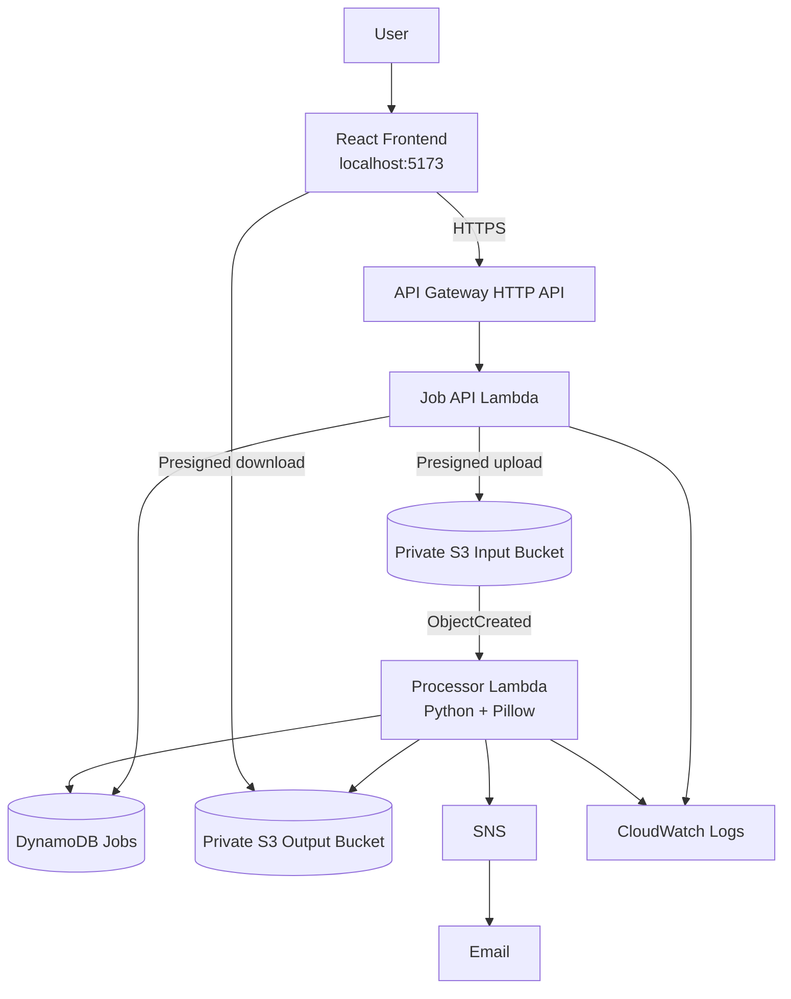

# Code Guide — ImagePreprocessing

A beginner-friendly tour of the codebase, plus interview preparation. Read it alongside
the code: every important file also has comments directly above its key blocks, and the
most interview-relevant ones are marked `INTERVIEW:`.

> **Tip:** search the repository for `INTERVIEW:` to jump to every interview note.

---

## 1. The system in one paragraph

A React app (running locally at `http://localhost:5173`) lets a user pick a JPG/PNG and
choose operations. It asks an **API Gateway** HTTP API to create a job. A **job-API
Lambda** stores the job in **DynamoDB** and returns a short-lived **presigned S3 upload
form**. The browser uploads the image **directly to a private S3 input bucket**. That
upload fires an **S3 event**, which starts the **processor Lambda**. The processor
validates the real file, runs **Pillow** to create the results, saves them to a
**private S3 output bucket**, updates DynamoDB, and sends an **SNS** email. Meanwhile the
browser **polls** the job status, then asks for **presigned download links** to preview
and download the results. Everything is created by **Terraform**, and all Lambda logs go
to **CloudWatch**.



The presigned-upload arrow means the job-API Lambda *signs* the upload form. The image
bytes themselves travel straight from the browser to the input bucket.

There is **no CloudFront and no frontend bucket**. The app is served from your own
machine by the Vite dev server. CloudFront was removed on purpose (it was blocked for
new accounts, and nothing in the backend needed it).

---

## 2. Suggested reading order

1. `backend/src/imgproc/image_ops.py`: pure image processing (no AWS), the easiest start.
2. `backend/src/imgproc/validation.py` and `tokens.py`: input rules and job tokens.
3. `backend/src/imgproc/jobs.py`: the DynamoDB state machine (the most interview-worthy file).
4. `backend/src/imgproc/job_api.py`: the four API routes.
5. `backend/src/imgproc/processor.py`: the S3-triggered worker.
6. `frontend/src/App.jsx` → `api.js` → the components.
7. `infra/*.tf`: how the AWS resources are wired together.
8. Tests: `backend/tests/`, `frontend/src/logic.test.js`, `frontend/e2e/app.spec.js`, `scripts/e2e_test.py`.

---

## 3. One request, step by step

| # | What happens | Code |
|---|---|---|
| 1 | User picks a file. The browser checks extension, size, magic bytes and dimensions. | `frontend/src/imageValidation.js`, `App.jsx` `handleSelect` |
| 2 | User ticks features and clicks **Process Image**. Options are checked and converted. | `options.js` `validateOptions` / `toOperations` |
| 3 | `POST /api/jobs` → API Gateway → job-API Lambda. | `api.js` `createJob` → `job_api.py` `handler` → `create_job` |
| 4 | Body validated, UUID job ID + random token created, job saved as `CREATED` (token **hash** only). | `validation.py` `parse_create_job`, `tokens.py`, `jobs.py` `create_job` |
| 5 | Lambda returns a 5-minute **presigned POST** (S3 enforces exact size + content type). | `job_api.py` `generate_presigned_post` |
| 6 | Browser uploads the file **directly to S3** (multipart form). | `api.js` `uploadToS3` |
| 7 | Browser calls `POST /api/jobs/{id}/complete-upload`. Lambda `HEAD`s the object, checks it, and sets status `UPLOADED`. | `job_api.py` `complete_upload`, `jobs.py` `mark_uploaded` |
| 8 | S3 `ObjectCreated` event invokes the processor Lambda (asynchronously). | `infra/s3.tf` `aws_s3_bucket_notification` → `processor.py` `handler` |
| 9 | Processor **claims** the job with a conditional write (status `PROCESSING`, claim ID, lease). | `jobs.py` `claim_job` |
| 10 | Downloads original, validates real content with Pillow, makes each result, uploads to `results/<id>/<variant>.<ext>`, records progress. | `processor.py` `run_job`, `image_ops.py` `load_image` / `process` |
| 11 | Marks job `COMPLETED` (fenced by claim ID), then sends an SNS email (best effort). | `jobs.py` `complete_job`, `processor.py` `notify` |
| 12 | Browser polls `GET /api/jobs/{id}` every 1.5 s and shows progress. | `App.jsx` `pollUntilDone`, `job_api.py` `get_status` |
| 13 | When `COMPLETED`, browser calls `GET /api/jobs/{id}/results` for 5-minute presigned preview/download links. | `job_api.py` `get_results` |
| 14 | Download click refreshes links first if they are about to expire. | `App.jsx` `freshResults` / `handleDownload` |

**Job statuses:** `CREATED → UPLOADED → PROCESSING → COMPLETED`, or `FAILED`. A transient
error moves `PROCESSING` back to `UPLOADED` so a retry can claim the job again.

---

## 4. File-by-file guide

### Backend (`backend/src/imgproc/`), shared by both Lambdas

| File | Purpose | Key ideas |
|---|---|---|
| `config.py` | Reads environment variables; creates boto3 clients (S3, DynamoDB, SNS). | Env-var config, regional S3 endpoint, SDK retries/timeouts, no credentials in code. |
| `limits.py` | `MAX_FILE_BYTES` (10 MB), with no Pillow import. | Exists because of the real "No module named 'PIL'" bug (see §8). |
| `tokens.py` | Create, hash (SHA-256) and verify job tokens. | Bearer token, hash-at-rest, constant-time comparison. |
| `validation.py` | Validate the create-job body and operation parameters. | Allow-list validation, strict integers, PNG has no quality setting. |
| `image_ops.py` | Validate image bytes and apply resize / grayscale / compress / pixelate. | Magic bytes, decompression-bomb limits, aspect ratio maths, lossy vs lossless, nearest-neighbour pixelation, fixed order. |
| `jobs.py` | DynamoDB job record and every status change. | Conditional writes, claim + lease, fencing, stale-claim recovery, deterministic S3 keys. |
| `job_api.py` | Job-API Lambda handler: the 4 routes. | Proxy-integration response shape, status codes, presigned POST/GET, idempotent complete-upload, no token logging. |
| `processor.py` | S3-triggered processor Lambda. | Event-driven, idempotency, transient vs permanent errors, retries, best-effort SNS. |

**Local only:** `backend/local/dev_server.py` runs the *real* handler code against moto
(mock AWS) and simulates the S3 trigger. It proves the logic, not the AWS integration.

### Frontend (`frontend/`)

| File | Purpose |
|---|---|
| `src/main.jsx` | Mounts `<App />` into `index.html`. |
| `src/App.jsx` | All state and the workflow: create → upload → confirm → poll → results → download → reset. |
| `src/api.js` | `fetch` wrapper for the 4 routes plus the direct S3 upload. Token goes in the `X-Job-Token` header. |
| `src/imageValidation.js` | Browser-side checks (UX only; the backend re-checks everything). |
| `src/options.js` | Default options, option validation, conversion to the API `operations` object. |
| `src/format.js` | Byte formatting and honest "% smaller / larger" text. |
| `src/components/*.jsx` | The six numbered steps of the UI (display only; state lives in `App.jsx`). |
| `vite.config.js` | Dev server on 5173; proxies `/api` to the local mock backend. |
| `.env.example` | Template. `scripts/configure_frontend.ps1` writes the real API URL to `.env.aws.local` for `npm run dev:aws`. |

### Infrastructure (`infra/`, Terraform)

| File | What it creates | Why |
|---|---|---|
| `versions.tf` | Provider requirements, AWS provider (region, default tags). | Pins versions; tags every resource with `Project` and `ManagedBy`. |
| `variables.tf` | Inputs (region, name prefix, email, CORS origins, retention, Lambda sizing, throttling). | Reusable config; validation blocks. |
| `main.tf` | Account lookup, random bucket suffix, shared `locals`. | Globally unique bucket names; one place for names. |
| `s3.tf` | 2 private buckets + Block Public Access, ACLs off, SSE-S3, versioning (off), lifecycle (1 day), CORS, HTTPS-only policy, **S3 → Lambda trigger**. | Secure storage and the event that drives processing. |
| `data.tf` | DynamoDB `imgprep-jobs` (on-demand, TTL) + SNS topic + email subscription. | Job tracking and notifications. |
| `iam.tf` | One role + inline least-privilege policy per Lambda. | Each function can touch only what it needs. |
| `lambda.tf` | Zips the build folders, log groups (14 days), both functions, env vars, async retry config, S3 invoke permission. | Packaging and running the code. |
| `api.tf` | HTTP API with CORS, Lambda proxy integration, 4 routes, `$default` stage with throttling + access logs, invoke permission. | Public HTTPS entry point. |
| `outputs.tf` | API URL, bucket/table/topic/function names, CORS origins. | Used by scripts and for inspection. |

### Scripts (`scripts/`)

| Script | Purpose |
|---|---|
| `build_lambda.ps1` | Builds `build/job_api` and `build/processor` (with **Linux** Pillow wheels). Run before `terraform plan/apply`. |
| `configure_frontend.ps1` | Writes the deployed API URL into `frontend/.env.aws.local`. |
| `e2e_test.py` | End-to-end checks over HTTP (28 checks against real AWS, including real link expiry). |

---

## 5. Tests: what kind, and what they prove

| Layer | Files | Type | Uses real AWS? |
|---|---|---|---|
| Image processing, validation, tokens | `backend/tests/test_image_ops.py`, `test_validation.py` | **Unit** | No |
| API routes, processor, state machine, failures | `backend/tests/test_job_api.py`, `test_processor.py` | **Integration** with mocked AWS (moto) | No (mocked) |
| Lambda packaging | `backend/tests/test_packaging.py` | Packaging regression test | No |
| Frontend logic | `frontend/src/logic.test.js` | **Unit** (Vitest) | No |
| Full UI in a real browser | `frontend/e2e/app.spec.js` | **End-to-end** (Playwright + Edge) | Local mock by default; also run against AWS |
| Whole deployed system over HTTP | `scripts/e2e_test.py` | **End-to-end** | Yes, when pointed at the deployed API |

**Why both mocks and real AWS?** Mocks are fast, free and repeatable, but they cannot
prove IAM permissions, S3 triggers, CORS or presigned-URL expiry. For example, moto does
not enforce link expiry or the presigned POST size rule. Those were verified only against
the real deployment.

---

## 6. `.gitignore`, explained

The file itself is commented line by line. In short:

| Ignored | Why |
|---|---|
| `.env`, `.env.*` (except `.env.example`) | Machine-specific settings. `frontend/.env.aws.local` holds the deployed API URL. |
| `*.pem`, `*.key`, `credentials`, `.aws/` | Keys and AWS credentials must never be committed. |
| `__pycache__/`, `*.py[cod]`, `.pytest_cache/`, `.coverage`, `htmlcov/` | Generated by Python and test tools. |
| `.venv/`, `venv/`, `node_modules/` | Installed dependencies; recreated with `pip install` / `npm install`. |
| `build/`, `dist/`, `*.zip`, `frontend/dist/` | Build output (Lambda packages, production bundle). |
| `.terraform/` | Provider plugins downloaded by `terraform init`. |
| `*.tfstate`, `*.tfstate.*` | **Terraform state** (and the backups in `infra/state-backups/`). It contains resource details and is needed to manage the infrastructure, so it is kept safe but never committed. |
| `*.tfvars` (except `*.tfvars.example`) | Personal values such as the notification email. |
| `*.tfplan`, `tfplan`, `crash*.log`, `*override.tf*` | Throwaway plan files, crash logs and personal overrides. |
| `frontend/e2e/.fixtures/`, `frontend/test-results/`, `frontend/playwright-report/` | Generated test images and browser-test reports. |
| `backend/local/.data/` | Reserved for local demo data (the current dev server keeps data in memory). |
| `.vscode/`, `.idea/`, `Thumbs.db`, `.DS_Store` | Editor and OS files. |

`infra/.terraform.lock.hcl` is deliberately **committed**: it pins provider versions.

---

## 7. Key concepts and interview questions

Each answer is grounded in this project.

**What does "serverless" mean here?**
No servers to manage: Lambda runs code on demand, API Gateway, S3, DynamoDB and SNS are
fully managed, and you pay per use. With no traffic, the cost is close to zero.

**Why presigned URLs instead of uploading through the API?**
The bucket stays private and no AWS credentials reach the browser. The URL grants one
action on one object for 5 minutes. Large files go straight to S3 instead of through
API Gateway/Lambda (which have payload limits and would cost more). With a presigned
*POST*, S3 itself enforces the exact size and content type. This was verified on AWS:
an oversized upload was refused by S3.

**What is event-driven architecture, and where is it used?**
Components react to events instead of calling each other. The upload creates an object,
S3 emits `ObjectCreated`, and Lambda runs. The API never calls the processor directly.

**What is idempotency, and how is it achieved?**
Doing something twice has the same effect as doing it once. Here:
- finished jobs skip duplicate events;
- `complete-upload` can safely be called twice;
- output keys are deterministic, so a retry overwrites instead of duplicating;
- conditional writes stop two workers from both processing the same job.

**Exactly-once processing?**
No. S3 events and Lambda retries are *at-least-once*. The design makes repeats safe
rather than impossible.

**How do conditional writes, leases and fencing work?**
`claim_job` sets `PROCESSING` *only if* the job is unclaimed, or its lease has expired.
DynamoDB evaluates that atomically, so only one worker wins. The lease (Lambda timeout +
30 s) lets a retry take over from a crashed worker. Every later write requires the same
`claimId`, so a slow, superseded worker cannot overwrite newer results.

**How are retries handled?**
S3 invokes the processor asynchronously, and Lambda retries a failed run twice. AWS and
network errors release the claim and re-raise, which triggers the retry. Bad images fail
immediately, since retrying cannot help. After 3 attempts the job becomes `FAILED`.

**Why doesn't an SNS failure fail the job?**
The job is marked `COMPLETED` *before* publishing, and publishing errors are caught and
logged. Notifications are best effort.

**How is the API secured without login?**
Each job has a random 256-bit token, returned once and kept only in the tab's memory.
It is sent in the `X-Job-Token` header (never in the URL). It is stored only as a
SHA-256 hash, compared in constant time, and never logged. A wrong token and an unknown
job both return 404. Throttling (10 req/s, burst 20) limits abuse. **Limitation:** this
is job-level authorization, not user authentication.

**What is least privilege in this project?**
Each Lambda role allows only the exact actions on the exact resources it uses: its own
log group, one table, and one key prefix per bucket. The processor cannot create jobs;
the API cannot write results. These policies were read back from AWS during the audit.

**What is CORS and where is it configured?**
Browsers block cross-origin responses unless the server allows the origin. API Gateway
(`api.tf`) and both buckets (`s3.tf`) allow only `http://localhost:5173`. CORS is not
authentication; it only restricts browsers.

**Which HTTP status codes does the API use?**
- `201` job created
- `200` OK
- `400` invalid input / rejected upload
- `401` missing token
- `404` unknown job or wrong token
- `409` wrong state (upload not found, results not ready)
- `413` body too large
- `429` throttled (from API Gateway)
- `500` unexpected error (generic message; details only in CloudWatch)

**How is the uploaded file validated?**
In the browser (UX), and again on the backend:
- declared name/type/size at job creation;
- S3 enforcing the exact size;
- `HEAD` checks at complete-upload;
- in the processor: magic bytes, Pillow `verify()` and full decode, max 10,000 px per
  side and 40 MP total, and declared type matching the real type.

**What is a decompression bomb?**
A tiny file that claims huge dimensions and explodes in memory when decoded. Dimensions
and pixel count are checked from the header *before* decoding, and Pillow's own bomb
warning is turned into an error.

**Explain the four operations.**
- **Resize:** one scale factor `min(maxW/w, maxH/h, 1)`, so the image never stretches or
  enlarges (LANCZOS filter).
- **Grayscale:** `L`, or `LA` to keep transparency.
- **Compression:** JPEG quality 10–100 (lossy); PNG lossless optimization, so files may
  not shrink.
- **Pixelation:** downscale to a grid of *level* blocks along the longer side (BOX), then
  upscale with NEAREST.

The fixed order is resize → grayscale → compress → pixelate.

**Why build Pillow specially for Lambda?**
Pillow contains compiled C code. Lambda runs Amazon Linux, so the package needs the
*Linux* wheel. `build_lambda.ps1` uses `pip install --platform manylinux... --only-binary`.

**What does Terraform state do, and why isn't it committed?**
It maps the code to real resource IDs; without it Terraform cannot update or destroy
what it created. It contains resource details, so it is git-ignored and backed up
manually.

**What are Terraform `variables`, `locals`, `outputs`, `data` and `depends_on`?**
- **Variables:** inputs.
- **Locals:** computed reusable values.
- **Outputs:** printed or exported values.
- **Data sources:** read existing information.
- **`depends_on`:** an explicit ordering rule that Terraform can't work out from
  references.

**How do you debug it in AWS?**
- `aws logs tail /aws/lambda/imgprep-processor` (structured JSON events such as
  `job_claimed`, `job_completed`, `duplicate_event_skipped`);
- the job's DynamoDB record;
- the S3 objects;
- API Gateway access logs.

---

## 8. A real bug worth talking about

After the first real deployment, every API call returned `500`. CloudWatch showed:

```
Runtime.ImportModuleError: Unable to import module 'imgproc.job_api': No module named 'PIL'
```

The job-API Lambda is packaged **without** Pillow, but it imported `MAX_FILE_BYTES` from
`image_ops.py`, which imports Pillow. Locally Pillow is installed, so all 120 mocked tests
passed.

**Fix:** move the constant into a Pillow-free module (`limits.py`).

**Prevention:** `tests/test_packaging.py` imports the API code in a separate process with
Pillow blocked.

**Lesson:** mocked tests can't catch packaging and integration problems. Real end-to-end
tests (`scripts/e2e_test.py`) are needed.

---

## 9. Known limitations (be upfront about these)

- **No user accounts:** only per-job tokens. A page reload loses the job.
- **No public hosting:** the frontend runs locally (CloudFront was removed).
- **At-least-once processing:** not exactly-once.
- **Delayed automatic cleanup:** S3 lifecycle and DynamoDB TTL run in the background, so
  data can remain somewhat longer than 1 day.
- **Limited concurrency:** the account allows 10 concurrent Lambda executions, and the
  processor has no reserved concurrency.
- **Local Terraform state:** there is no remote backend.

---

## 10. Glossary

| Term | Meaning |
|---|---|
| ARN | Amazon Resource Name, the unique ID of an AWS resource. |
| boto3 | AWS SDK for Python. |
| Bucket / key / prefix | S3 container / object name / leading part of names (like a folder). |
| Conditional write | A DynamoDB write that succeeds only if a condition on the current item is true. |
| CORS | Browser rule controlling which origins may read cross-origin responses. |
| Fixture (pytest) | Reusable test setup, injected by naming it as a test parameter. |
| Idempotent | Safe to repeat; same final result. |
| Lease | Time-limited ownership of a job by one worker. |
| Mock | A fake replacement for a real dependency in tests (moto fakes AWS). |
| Presigned URL / POST | Time-limited, signed permission for one S3 action. |
| Proxy integration | API Gateway passes the whole request to Lambda and returns its response. |
| TTL | Automatic deletion of DynamoDB items after a timestamp. |
| Wheel | A pre-built Python package file (`.whl`). |
